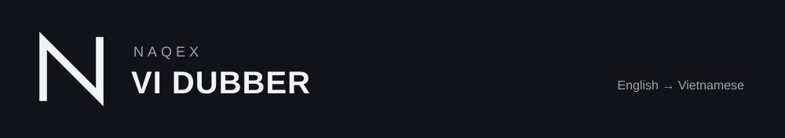
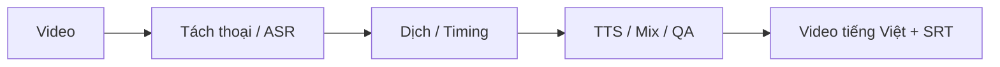

<p align="center"></p>

Lồng tiếng video English → Vietnamese, giữ nhạc/SFX, xuất video và phụ đề.
Nhận tệp local hoặc URL YouTube qua CLI và web dashboard.

[](https://github.com/Naqex/vi-dubber/actions/workflows/checks.yml)
[Setup và vận hành](docs/development/README.md) · [Plan](PLAN.md) · [License](docs/licensing.md)



## Bắt đầu trên Windows

```powershell
git clone https://github.com/Naqex/vi-dubber.git
cd vi-dubber
.\setup.ps1
.\start-web.ps1
```

Mở `http://127.0.0.1:7860`. Setup cài dependencies/tools local và model có thể
được tải ở lần dùng đầu; cần đủ dung lượng và cấu hình phù hợp.

Backend dịch hiện dùng Dedicated Dubber-WebGPT riêng tại `127.0.0.1:17850`.
Core và đăng nhập provider phải được chuẩn bị theo [runtime setup](docs/development/README.md);
checkout repository không bao gồm login state, model hoặc provider core.

| Muốn làm gì? | Tài liệu / lệnh |
|---|---|
| Dùng CLI, voice reference hoặc nhiều người nói | [Setup và vận hành](docs/development/README.md) |
| Kiểm tra máy | `uv run vi-dubber doctor` |
| Sửa backend / pipeline | `src/vi_dubber/` và `tests/` |
| Sửa dashboard | `frontend/` và [UI contract](frontend/PRODUCT-UI-CONTRACT.md) |
| Đọc việc còn mở và bằng chứng QA | [PLAN.md](PLAN.md) |

## Trạng thái và quyền sử dụng

Pipeline có resume và kiểm tra artifact theo manifest/hash; preview chưa thay
thế nghiệm thu video cuối. Trạng thái acceptance nằm trong PLAN. Aurora và
adapter local/hybrid được giữ cho rollback/test, không tự fallback từ WebGPT.

Copyright (c) 2026 Naqex. [Naqex Source Available License](LICENSE) và
[chính sách license](docs/licensing.md) quy định quyền dùng/sửa/phân phối;
khai thác thương mại cần giấy phép riêng. Model, provider và dependency
có điều khoản riêng. Không đưa credential hoặc media riêng tư vào Git.
